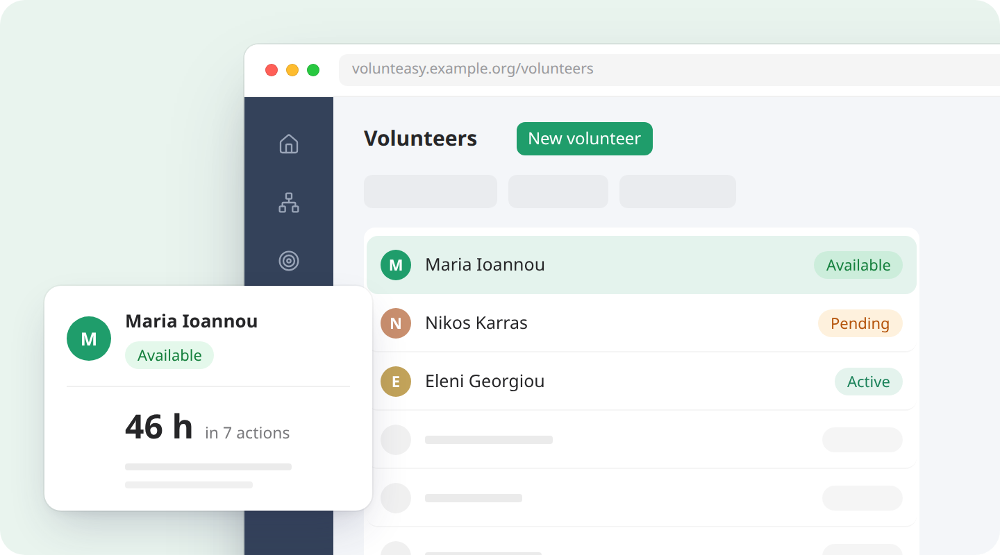
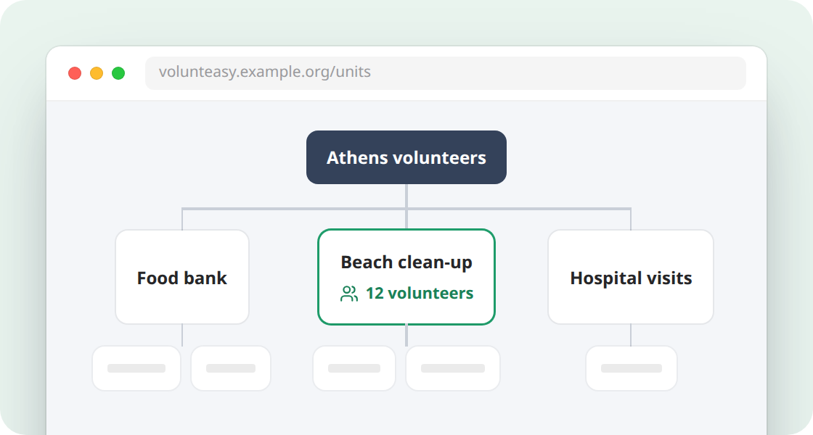
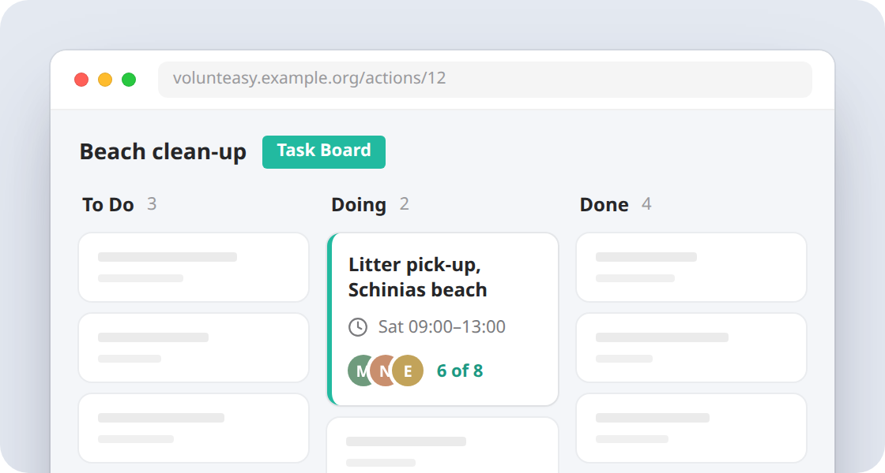
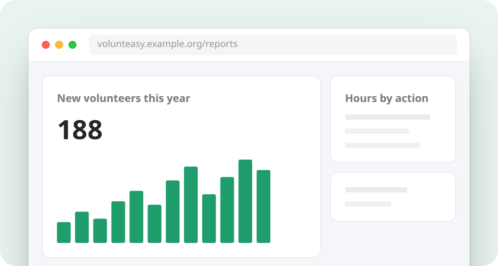

<p align="center">
  
</p>

<p align="center">
  <strong>Open-source volunteer management for non-profits, municipalities and community groups.</strong><br>
  Register volunteers, organise them in units, plan actions and shifts, and measure the impact.
</p>

<p align="center">
  <a href="https://github.com/scify/VoluntEasy/actions/workflows/ci.yml"></a>
  <a href="LICENSE.TXT"></a>
  
  
  
</p>

<p align="center">
  <a href="https://scify.github.io/VoluntEasy/"><strong>Website</strong></a> ·
  <a href="#quick-start">Quick start</a> ·
  <a href="#features">Features</a> ·
  <a href="#contributing">Contributing</a>
</p>

<p align="center">
  
</p>

---

## Why VoluntEasy?

Organisations that work with volunteers often keep them in spreadsheets, e-mail threads and paper forms. VoluntEasy puts everything in one web application:

- **One record per volunteer**, with skills, languages, availability, interests, files and the full history.
- **Teams that match your organisation**: a tree of units, each with its own coordinators and onboarding steps.
- **Actions that get staffed**: task boards, shifts with the number of volunteers you need, and a public page where volunteers choose a shift.
- **Feedback and numbers**: questionnaires after each action, ratings, and reports with charts.

It is free, it runs on your own server, and your data stays with you: no tracking and no third-party services.

## Features

<table>
  <tr>
    <td width="50%" valign="top">
      <br>
      <strong>Units and onboarding.</strong> Model your organisation as a tree of units. Each unit has coordinators and onboarding steps (for example a first contact, an interview and a training). A volunteer is <em>pending</em> until the steps are complete, then <em>available</em>, and <em>active</em> while in an action.
    </td>
    <td width="50%" valign="top">
      <br>
      <strong>Actions, tasks and shifts.</strong> Every action has a task board with tasks, subtasks, checklists and shifts. Assign users and volunteers, drag work from <em>To do</em> to <em>Done</em>, and publish a call-to-action page for sign-ups.
    </td>
  </tr>
  <tr>
    <td width="50%" valign="top">
      <br>
      <strong>Reports.</strong> New volunteers per month, age groups, gender, cities, education levels, interests and the hours given per action. Print the tables or export them to CSV.
    </td>
    <td width="50%" valign="top">
      <strong>And also</strong>
      <ul>
        <li>Detailed volunteer profiles and a search on every field</li>
        <li>Public volunteer form and a JSON endpoint for your website</li>
        <li>Questionnaires by e-mail after an action, for volunteers and coordinators</li>
        <li>Ratings of actions and of volunteers</li>
        <li>Collaborations with partner organisations</li>
        <li>In-app notifications</li>
        <li>Roles: administrator, unit manager, action manager</li>
        <li>English and Greek user interface</li>
        <li>Deployment "flavours" to adapt forms, ratings and reports</li>
      </ul>
    </td>
  </tr>
</table>

## Quick start

Requirements: **PHP 8.3+** (with `pdo_mysql`, `mbstring`, `intl`, `zip`), **Composer**, and **MySQL 8 or MariaDB 10.6+**.

```bash
git clone https://github.com/scify/VoluntEasy.git
cd VoluntEasy/VoluntEasy
composer install
cp .env.example .env
php artisan key:generate
```

Edit `.env` (database, mail, `APP_URL`, the first administrator), then create the database tables and the reference data:

```bash
php artisan migrate --seed
php artisan serve
```

Open <http://localhost:8000> and log in as the administrator. If you did not set `ADMIN_PASSWORD`, the seeder prints a random password: change it after the first login.

### Configuration

The settings are in `.env`. The ones specific to VoluntEasy:

| Variable | Meaning |
|---|---|
| `PLATFORM_NAME` | The name in the page titles and e-mails, for example `VoluntEasy` |
| `MODE` | The deployment flavour: `scify`, `municipality` or `ekpizo` (see below) |
| `APP_LOCALE` | The default language: `el` or `en` |
| `ADMIN_EMAIL`, `ADMIN_PASSWORD` | The first administrator, created by `php artisan db:seed` |
| `DB_STRICT` | MySQL strict mode; `false` by default for compatibility with existing databases |

### Scheduled jobs

After an action ends, VoluntEasy sends the questionnaires, and it makes volunteers available again when their "not available" period ends. Run the Laravel scheduler every minute:

```cron
* * * * * cd /path/to/VoluntEasy/VoluntEasy && php artisan schedule:run >> /dev/null 2>&1
```

### Web server

Point the document root of your virtual host to `VoluntEasy/public`, and give the web server write access to `storage/` and `bootstrap/cache/`. See the [Laravel deployment guide](https://laravel.com/docs/13.x/deployment) for Nginx and Apache examples.

## Deployment flavours

A flavour changes parts of the application for one organisation without a fork. Each one is a folder in [`VoluntEasy/dependencies/`](VoluntEasy/dependencies) with:

- a `configuration` (the view folders, the extra volunteer fields),
- a `VolunteerServiceImpl` (the volunteer form and its validation),
- a `RatingServiceImpl` (the rating pages),
- a `ReportsService` (extra reports),
- its own views and reference data.

The common behaviour is in [`VoluntEasy/interfaces/`](VoluntEasy/interfaces). Choose the flavour with `MODE` in `.env`.

## Development

```bash
php artisan test                 # PHPUnit: unit and feature tests
vendor/bin/phpstan analyse       # Larastan (level 5)
vendor/bin/pint                  # code style (Laravel preset)
php artisan lang:js              # rebuild public/messages.js after a change in resources/lang
```

The front end uses plain JavaScript: [`public/assets/js/ve.js`](VoluntEasy/public/assets/js/ve.js) contains the shared helpers (requests with the CSRF token, tables, date pickers, inline editing). The libraries are self-hosted in `public/assets/vendor`.

GitHub Actions runs Pint, Larastan and the tests on every push and pull request.

## Contributing

Contributions are welcome:

- **Report a bug or suggest a feature** in the [issues](https://github.com/scify/VoluntEasy/issues).
- **Translate** the interface: the texts are in `VoluntEasy/resources/lang/<language>/`.
- **Send a pull request**: keep `php artisan test`, `vendor/bin/phpstan analyse` and `vendor/bin/pint --test` green.

Please report security problems privately to SciFY ([scify.org](https://www.scify.org/)) and not in a public issue.

## License

VoluntEasy is released under the [Apache License 2.0](LICENSE.TXT).
